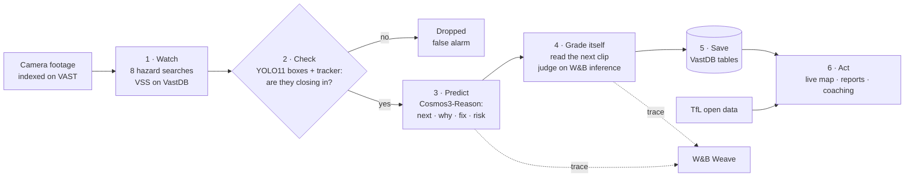
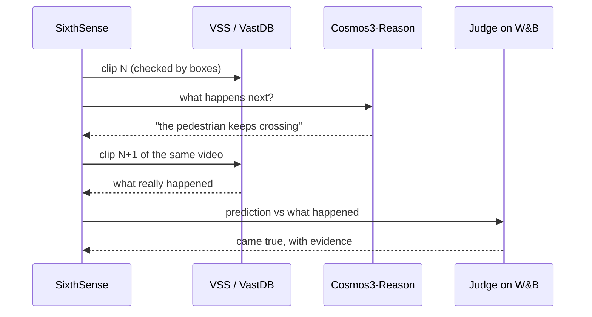

<div align="center">

# SixthSense

### Every London bus, a second pair of eyes.

**SixthSense watches bus camera footage, warns about close calls, and checks the next clip to see if it was right.**

[](https://github.com/vast-data/vast-builders-challenge)
[](https://www.nvidia.com/en-us/ai/cosmos/)
[](https://coreweave.com/)
[](https://wandb.ai/site/weave/)

[Try it](#try-it) · [How it works](#how-it-works) · [Results](#results) · [Run it](#run-it) · [Team](#team)

</div>

---

## The problem

London has 25,000 bus drivers, and TfL's goal is that no one is killed on or by a London bus by 2030 ([TfL, 2018](https://tfl.gov.uk/info-for/media/press-releases/2018/october/london-s-bus-network-to-meet-new-world-leading-bus-safety-standard)).

Buses already carry cameras. But the footage is usually pulled only after something goes wrong. Nobody has time to watch it all, so the near misses that come before a crash, and the patterns behind them, go unseen. Safety teams often learn about a risky junction or habit only after someone is hurt.

Most camera footage is never watched. The few seconds that matter deserve a second look.

## What SixthSense does

SixthSense helps a bus safety team see which buses had a close call, what happened, and what to do about it.

| Step | What happens |
|---|---|
| **Watch** | Searches every clip for 8 kinds of bus hazard, like a cyclist on the nearside or a pedestrian stepping out. |
| **Check** | Confirms two road users are really getting closer, and drops false alarms before anyone sees them. |
| **Predict** | Says what happens in the next few seconds, why, and what the driver should do. |
| **Grade itself** | Watches the next clip and marks the prediction: came true, partly, or didn't happen. |
| **Report and coach** | A prediction that came true becomes a near-miss report. Patterns on a route become driver coaching. |

Most video AI demos say they are accurate. SixthSense measures it on the day, with no hand labels.

> **What's live and what's a stand-in.** Bus positions are live TfL open data, placed at each bus's next stop. The camera clips are the hackathon footage from San Francisco and New York, standing in for bus cameras, and matching an incident to a live bus is a stand-in too. Every prediction, check and score you see comes from our real run on VAST.

---

## Try it

- **Live app:** [homepage](https://team-43-app.thecosmoslabs.com/app/) · [live map](https://team-43-app.thecosmoslabs.com/app/dashboard/) (needs lab access, and may go offline after the event)
- **Traces:** [every model call in W&B Weave](https://wandb.ai/vastdata/team-43/weave)
- **Demo video:** _link coming_

A 60-second walk through:

1. **Live map.** Every London bus is tracked from TfL open data. Only the buses with a reported incident are drawn, numbered by priority, each with its route.
2. **Open #1.** See the hazard and the place, like *"Pedestrian stepping out · Route 34 near Walthamstow Market"*. Play the clip, read the prediction and the advice for the driver.
3. **Act.** Nudge the driver, open the report, or follow the bus.
4. **The report.** Before, prediction, what happened, outcome. Sign it off or send it to the garage.
5. **Coaching.** Each route gets one card: the most common hazard and one habit to try.

---

## How it works



| Step | What it does | Built with |
|---|---|---|
| Watch | Runs 8 bus hazard searches across the city and street cameras, taking results from each in turn and skipping near-duplicates. | VSS hybrid search over **VastDB** |
| Check | Tracks each road user frame by frame and measures the gap between pairs in car lengths. A clip passes only if a pair really closes in. | **YOLO11** boxes, supervision and a ByteTrack tracker |
| Predict | Treats the clip as a London bus front camera and returns a hazard type, what happens next, why, a fix for the driver, and a risk score. | **NVIDIA Cosmos3-Reason** on **CoreWeave** |
| Grade itself | Finds the next clip of the same video and asks a judge whether the prediction came true, with evidence. | A model on **W&B inference**, traced in **Weave** |
| Save | Stores incidents and runs. | **VastDB** tables `incidents` and `runs` |
| Act | Shows the live map, the report inbox and coaching. Polls TfL for every bus route and pushes positions to the browser. | FastAPI, Socket.IO, Next.js, Mapbox GL |

<details>
<summary><b>The gap check, in detail</b></summary>

Each 5-second clip carries YOLO11 boxes for all 150 frames. SixthSense:

1. Tracks each road user with ByteTrack, one tracker per clip.
2. For every pair that includes at least one vehicle, measures the distance between them in car lengths, smoothed to remove jitter.
3. Keeps pairs that end up close and closed in fast enough.

```
gap(t)   = centre distance / average box size     # in car lengths
score    = (gap(start) - gap(min)) / gap(start)
note     = "a car and a pedestrian closed from 1.7 to 0.5 car lengths in 1.4s"
```

This is a 2D closing-gap score, not time to collision. Flat boxes don't give true speed or distance, so we don't claim they do.
</details>

<details>
<summary><b>The prediction prompt, in short</b></summary>

```text
You are a London bus safety analyst. Treat this camera as the front camera of a London bus.
Look only at what is visible. Answer in JSON:
type (one of 8 bus hazards), what_happens, what_next, why, fix (advice to the bus driver), risk 1-5.
Name the specific road users, colours, sides and distances. One sentence each.
Never invent people, vehicles or events you cannot see.
```
</details>

<details>
<summary><b>How it grades itself</b></summary>



`accuracy = (came true + 0.5 × partly) / checked`. Predictions with no next clip are marked unknown and left out.
</details>

---

## Results

Only numbers from today's live runs (17 Oct 2026). Nothing is estimated.

| Run | Cameras | Clips | Passed the gap check | Graded | Came true |
|---|---|---|---|---|---|
| **Bus safety** | 8 hazard searches over the city and street cameras | 10 | 7 (3 false alarms dropped) | 7 | **4 of 7** |
| City | 6 New York and San Francisco intersections | 10 | 9 | 8 | **5 of 8** |
| City, earlier run | same | 10 | 7 | 6 | 4 of 6 |
| Highway | I-24 Nashville | 10 | 0 | 0 | - |
| Street | one street, two days | 10 | 0 | 0 | - |

Across both city runs, 9 of 14 graded predictions came true. The bus run found three kinds of hazard: pedestrian stepping out, blocked lane, and vehicle cutting in.

Highway and street raised no warnings: no clip had a pair closing in fast enough to pass the gap check. SixthSense stays quiet rather than guessing.

### A real incident, unedited

```json
{
  "camera_id": "sf_streets_cam-1",
  "type": "Pedestrian stepping out",
  "verified": true,
  "verify_note": "a car and a pedestrian closed from 1.7 to 0.5 car lengths in 1.4s",
  "what_happens": "A pedestrian on a scooter steps out from the right side of the road into the crosswalk, moving towards the left side of the frame.",
  "what_next": "The pedestrian continues to cross the road, moving further into the crosswalk.",
  "why": "The pedestrian is crossing the road at the crosswalk, likely following the traffic signal.",
  "fix": "The bus should slow down and stop to allow the pedestrian to cross safely.",
  "risk": 3,
  "came_true": "yes",
  "came_true_evidence": "The pedestrian is seen advancing through the crosswalk, moving steadily toward the other side of the street."
}
```

---

## Built on the CAMP stack

| Layer | Provider | How SixthSense uses it |
|---|---|---|
| **C** · Coding agent | Claude Code | Planned, built, tested and deployed the app on the day, using the challenge's VSS skills. |
| **A** · Agent runtime | **VAST** | The agent and the app run in the team's Kubernetes namespace on VAST. |
| **M** · Model services | **CoreWeave + NVIDIA + W&B** | Cosmos3-Reason predicts, YOLO11 boxes check, Cosmos Embed1 powers search, and a model on W&B inference grades. |
| **P** · Platform | **VAST AI OS** | Video in VAST S3. Clips, vectors, detections and our own incidents and runs live in **VastDB**. |

The footage: one VastDB index of 3,537 five-second clips from 612 videos across 13 cameras, already processed by the VAST DataEngine pipeline.

---

## Run it

On the challenge lab VM. Credentials come from `/config/<team>.config` and are never printed.

```bash
git clone https://github.com/Dinesh-Sunny/sixthsense && cd sixthsense

./scripts/release.sh                      # builds the web app, pushes a dist branch, prints DIST_SHA
bash deploy.sh <DIST_SHA>                 # starts the sixthsense-v1 deployment
bash deploy.sh --cutover                  # points /app at it
bash deploy.sh --rollback                 # goes back to the previous app

# Inside the pod
sixthsense probe                          # checks every service: ok or fail
sixthsense run --mode bus --limit 10      # watch, check, predict, grade, save
```

Local development:

```bash
cd backend && uv sync && uv run pytest -q && uv run ruff check
uv run uvicorn sixthsense.main:create_asgi --factory --port 8080
cd ../web && pnpm install && pnpm dev     # NEXT_PUBLIC_API_ORIGIN=http://localhost:8080
```

There is no image build. When the pod starts, it downloads the `dist` commit by its SHA, installs `uv`, and runs `uv sync --locked`. The Mapbox token and other keys come from a Kubernetes secret, never from git.

### Project structure

```
sixthsense/
├── backend/src/sixthsense/
│   ├── main.py        # FastAPI app, Socket.IO, API routes, health checks, serves the web app
│   ├── pipeline.py    # watch, check, predict, grade
│   ├── modes.py       # bus, city, road and street searches and prompts
│   ├── tracking.py    # ByteTrack and the gap check
│   ├── tfl.py         # live London buses from TfL open data
│   ├── store.py       # VastDB tables, with a JSON fallback
│   ├── clients/       # VSS, Cosmos and W&B clients
│   └── cli.py         # sixthsense run | probe
├── backend/tests/     # 76 tests, no network
├── web/               # Next.js 16 static app: homepage, live map, reports, coaching
├── deploy.sh · deploy/bootstrap.py · scripts/release.sh
└── docs/              # design system and wireframes
```

---

## Design decisions

| Decision | Why |
|---|---|
| Predict, then grade | A prediction you can check is worth more than a caption you have to trust. |
| Boxes before the big model | A cheap gap check drops false alarms before the expensive call. |
| Show only buses that need a look | Six thousand dots tell you nothing. Seven numbered buses tell you where to start. |
| One engine, many modes | Bus, city, road and street differ only in searches and prompts. |
| Coaching, not a league table | Drivers see their own clips first. |
| Honest numbers | Stand-ins are labelled. Every number is from a real run. |

## Limits

- The gap check works on flat boxes, so it is a proxy, not true speed or distance.
- "Came true" is judged from the next clip's description, so it is only as good as that description.
- The clips are not from London buses yet, and the incident-to-bus match is a stand-in.
- 10 clips per run is a small sample. 9 of 14 is a signal, not a benchmark.

## Next

- Connect real bus front cameras.
- Tune the ingest prompt for bus hazards and measure before and after in Weave.
- Send nudges to the driver's cab and reports to the garage's system.

---

## Team

| | |
|---|---|
| **Dinesh Sunny** | Product and AI agents. Built the agent loop, the app and the story. · [LinkedIn](https://www.linkedin.com/in/dinesh-potluru-a967866a/) · [GitHub](https://github.com/Dinesh-Sunny) |
| **Denesh Ashok** | London buses expertise and the live fleet map. · [LinkedIn](https://www.linkedin.com/in/deneshashok/) |

## Thanks

VAST Data, NVIDIA, CoreWeave, Weights & Biases and tokens& for the stack, the footage and the day. Bus data powered by TfL Open Data. Weather by Open-Meteo.

<div align="center"><sub>Every London bus, a second pair of eyes.</sub></div>
