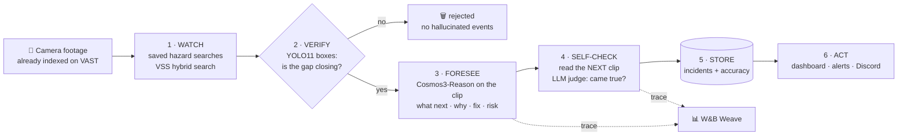
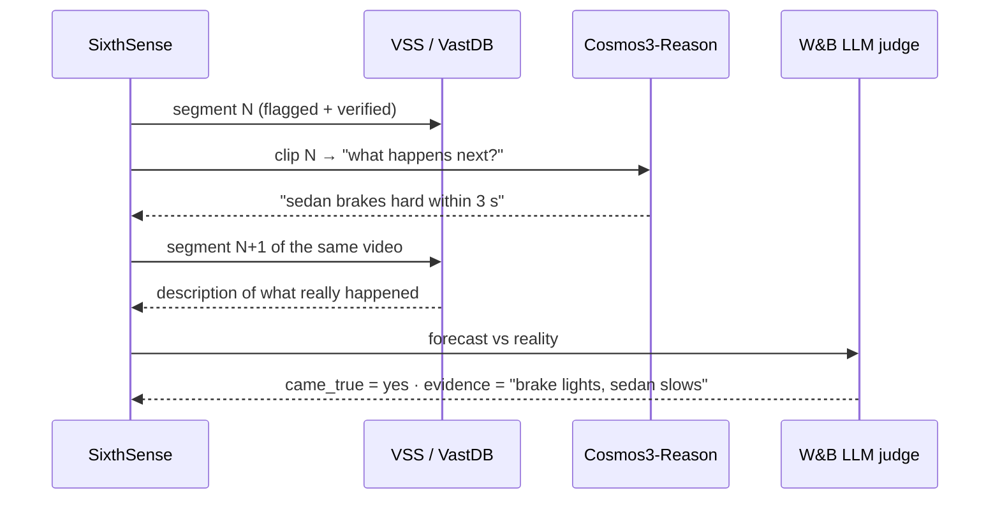

<div align="center">

# 👁️ SixthSense

### Every London bus, a second pair of eyes.

**A video agent for London's bus network: it warns before a close call, checks what really happened, files the report and turns the pattern into driver coaching.**

[](https://github.com/vast-data/vast-builders-challenge)
[](https://www.nvidia.com/en-us/ai/cosmos/)
[](https://docs.ultralytics.com/models/yolo11/)
[](https://coreweave.com/)
[](https://wandb.ai/site/weave/)
[](#-run-it)

[Demo](#-demo) · [How it works](#-how-it-works) · [CAMP stack](#-built-on-the-camp-stack) · [Results](#-results) · [Run it](#-run-it) · [For judges](#-for-the-judges)

</div>

---

## ⚡ TL;DR

London has **25,000 bus drivers**, and TfL's Vision Zero goal is that **no one is killed on or by a London bus by 2030** ([TfL, 2018](https://tfl.gov.uk/info-for/media/press-releases/2018/october/london-s-bus-network-to-meet-new-world-leading-bus-safety-standard)). Buses already carry cameras, but the footage is usually pulled only *after* something goes wrong.

SixthSense gives a bus safety team one live map of every London bus and an agent loop on top of the camera footage:

| | Agent | What it does |
|---|---|---|
| 👀 **Watch** | Watcher | searches every new clip for risky moments (cyclists on the nearside, people stepping out, tight pull-outs) |
| ⚠️ **Pre-incident** | Checker + Forecaster | YOLO boxes confirm two road users are really closing in; Cosmos3-Reason predicts the next seconds, says why and suggests a fix |
| 📣 **Act** | Dispatcher | a calm nudge to the driver and a pin on the control room map |
| ✅ **Post-incident** | Grader + Reporter | reads the *next* clip, grades its own forecast, and files the near-miss report when it came true |
| 🎓 **Coach** | Coach | weekly coaching from the driver's own clips: supportive, never a league table |

Most video AI demos *claim* they are accurate. **SixthSense measures it, on the day, with no hand labels.**

> **Honest about today.** Bus positions are **live TfL open data** (estimated at each bus's next stop). The camera clips are the hackathon's San Francisco and New York footage, used as a **labelled stand-in** for bus cameras, and pairing an incident to a live bus is a stand-in too. Every forecast, check and score is from our real run on VAST.

---

## 🎬 Demo

> 📹 **Demo video:** _added after the live run (link here)_ · 🌐 **Live app:** [homepage](https://team-43-app.thecosmoslabs.com/app/) · [dashboard](https://team-43-app.thecosmoslabs.com/app/dashboard/) (lab access needed; it may go offline after the event)

<!-- screenshot: docs/screenshot.png added after the live run -->

**The 60-second story**
1. **Live map**: every London bus moving on a Mapbox map, fed by TfL open data over Socket.IO. Pick route 18, follow a bus.
2. **Needs a look**: a bus pulses red. Open it: the camera clip, the forecast (*"the pedestrian will complete crossing the street"* after a car cut in close), why, and the fix.
3. **What the agents did**: spotted → driver nudged → pinned on the map → checked the next clip: ✅ **came true** → near-miss report filed.
4. **Reports** and **Coaching**: the report writes itself; the weekly coaching card is built from the driver's own clips.
5. The header shows how many forecasts came true today, every step traced in W&B Weave.

---

## 🧩 The problem

| Pain | Today | With SixthSense |
|---|---|---|
| Bus camera footage | Pulled only after an incident | Watched continuously by an agent |
| "Search" tools | Find what *already* happened | Predict what happens **next** |
| AI hallucination | Model says an event happened; nobody checks | **YOLO boxes verify** every flagged moment |
| Trust | Vendors quote accuracy from a lab | The agent **grades itself** on your own footage |

---

## 🧠 How it works



| # | Step | What it does | Code | Powered by |
|---|---|---|---|---|
| 1 | **Watch** | Runs saved hazard queries per camera ("truck cutting in close", "sudden hard braking") | `pipeline.py · watch` | VSS search over **VastDB** (Cosmos Embed1 256-d vectors) |
| 2 | **Verify** | Measures how fast the gap between two vehicle boxes shrinks; rejects anything that isn't really closing | `tracking.py` | **YOLO11** boxes + supervision/trackers ByteTrack |
| 3 | **Foresee** | Sends the clip to the reasoning model with a strict JSON prompt | `pipeline.py · foresee` | **NVIDIA Cosmos3-Reason** on **CoreWeave** |
| 4 | **Self-check** | Finds the next segment of the same video and asks a judge if the forecast came true | `pipeline.py · selfcheck` | **W&B serverless inference** (Llama-3.3-70B) |
| 5 | **Store** | Writes incidents + per-mode accuracy | `store.py` | **VastDB** tables `incidents` + `runs` |
| 6 | **Act** | Cards, risk badges, "came true" pills, alerts, ask-the-footage box | `web/` + `main.py` | Next.js static export + FastAPI on **VAST K8s** |

<details>
<summary><b>🔍 Step 2 in detail - tracking-lite closing-gap score</b></summary>

Each 5-second segment carries YOLO11 boxes for all 150 frames. SixthSense:

1. **Tracks** each road user frame to frame (greedy IoU matching, same label only) - a tiny multi-object tracker in ~40 lines.
2. For every pair that includes **at least one vehicle**, measures centre distance in **car lengths** (distance / average box diagonal), smoothed to remove ID jitter.
3. Keeps pairs that end up within **1.5 car lengths**, and scores how much they closed in:

```
d(t)     = centre distance / mean box diagonal        # "car lengths"
score    = (d(start) - d(min)) / d(start)
verified = score >= 0.30 and d(min) <= 1.5
note     = "a pedestrian and a car closed from 4.1 to 0.9 car lengths in 4.9s"
```

This is a **closing-gap score**, not time-to-collision: 2D boxes don't give true speed or distance, so we don't pretend they do.
</details>

<details>
<summary><b>🔮 Step 3 in detail - the forecast prompt</b></summary>

```text
You are a road-safety analyst watching highway CCTV. Look only at what is visible in this clip.
Answer in JSON only:
{"type", "what_happens", "what_next" (next 5-10 s), "why", "fix", "risk": 1-5}
If nothing risky is happening, set risk to 1 and what_next to "nothing notable".
Never invent people, vehicles or events you cannot see.
```
</details>

<details>
<summary><b>✅ Step 4 in detail - self-check with no hand labels</b></summary>



`accuracy = (yes + 0.5 × partly) / checked`. Forecasts with no next segment are marked `unknown` and left out.
</details>

---

## 🏕️ Built on the CAMP stack

The Builders Challenge maps to VAST's **CAMP** stack. SixthSense uses every layer:

| Layer | Provider | How SixthSense uses it |
|---|---|---|
| **C** - Coding agent | Cursor (+ Claude Code) | Built the whole app on the day from the challenge's `.cursor/skills` |
| **A** - Agent runtime | **VAST** | The agent and the app run on the team's VAST Kubernetes namespace; ingest runs as VAST DataEngine functions |
| **M** - Model services | **CoreWeave + NVIDIA** | Cosmos3-Reason (forecast), Cosmos Embed1 (search vectors), YOLO11 (verification) on CoreWeave GPUs; W&B inference for the judge |
| **P** - Platform | **VAST AI OS** | Video in VAST S3, segments + vectors + detections in **VastDB**, one index across every camera |

---

## 📊 Results

> Only numbers from today's real run go here. Nothing is estimated in advance.

| Mode | Camera | Candidates | Verified | Checked | Came true | Accuracy |
|---|---|---|---|---|---|---|
| 🚌 Bus safety | 8 hazard searches over the city + street cams | 10 | 7 | 7 | **4** | **4 of 7 (57%)** |
| 🚦 City | NYC + SF intersection cams (6) | 10 | 9 | 8 | **5** | **5 of 8 (63%)** |
| 🛣️ Road | `i24_cam-1` (Nashville I-24 highway) | 10 | 0 | 0 | - | - |
| 🏘️ Street | `neighborhood_cam-1` (2 days) | 10 | 0 | 0 | - | - |

Latest live run, 17 Oct 2026, 10 clips per mode. An earlier 10-clip city run scored 4 of 6, so across both city runs 9 of 14 checked forecasts came true. The bus safety run searches for 8 bus hazards (cyclist on the nearside, pedestrian stepping out, vehicle cutting in, car pulling out, blocked lane and more) and labels each one; 3 of its 10 candidates were ruled out by the box check. Results are stored in VastDB (schema `sixthsense`, tables `incidents` + `runs`).
Road and Street raised no warnings: no clip showed a vehicle pair closing in fast enough to pass the box check. That is the filter doing its job - SixthSense stays quiet rather than guessing.

Every forecast and grade is traced in Weave: [wandb.ai/vastdata/team-43/weave](https://wandb.ai/vastdata/team-43/weave)

---

## 🎥 The footage

One VastDB index, **3,537 five-second segments from 612 videos across 13 cameras**, pre-processed by the VAST DataEngine pipeline (Cosmos3-Reason captions, Cosmos Embed1 vectors, YOLO11 boxes for every frame).

| Mode | Cameras | Why it's here |
|---|---|---|
| 🛣️ Road | `i24_cam-1` - Nashville I-24, overhead multi-cam | lane changes, cut-ins, braking at speed |
| 🚦 City | `nyc_streets_cam-1/2`, `sf_streets_cam-1/2/4/5` | pedestrians, cyclists and turning cars sharing space |
| 🏘️ Street | `neighborhood_cam-1` - two full days | repeat visits, day-over-day patterns |

## 🗂️ Example output

```json
{
  "camera_id": "sf_streets_cam-4",
  "type": "close cut-in",
  "verified": true,
  "verify_note": "a car and a pedestrian closed from 2.6 to 0.5 car lengths in 2.1s",
  "what_happens": "A white sedan cuts in close to a pedestrian crossing the street, creating a near-miss.",
  "what_next": "The white sedan will continue moving forward, and the pedestrian will complete crossing the street.",
  "why": "The driver of the white sedan failed to yield to the pedestrian, resulting in a dangerous close pass.",
  "fix": "Implement stricter enforcement of right-of-way rules and increase pedestrian awareness campaigns.",
  "risk": 4,
  "came_true": "yes",
  "came_true_evidence": "The white sedan continues moving forward along the road, and the pedestrian with the stroller finishes crossing the street.",
  "trace_url": "https://wandb.ai/vastdata/team-43/r/call/01a149b0-31b3-7164-8fe0-97f5435d109c"
}
```
<sub>A real incident from the live city run, unedited. A miss looks the same with `"came_true": "no"` and the evidence saying what really happened.</sub>

---

## 🚀 Run it

On the challenge lab VM (credentials and endpoints are already in `/config/<team>.config`):

```bash
git clone https://github.com/Dinesh-Sunny/sixthsense && cd sixthsense

# Build and publish: web static export + backend source go to an orphan `dist` branch
./scripts/release.sh                      # prints DIST_SHA=<40-hex>

# On the lab VM (credentials come from /config/<team>.config, never printed)
bash deploy.sh <DIST_SHA>                 # second deployment `sixthsense-v1` at /v1
bash deploy.sh --cutover                  # point /app at it (old app kept)
bash deploy.sh --rollback                 # instant way back

# Inside the pod
sixthsense probe                          # every API: ok / fail, no secrets
sixthsense run --mode city --limit 10     # watch → verify → foresee → self-check → VastDB
```

Local development:

```bash
cd backend && uv sync && uv run pytest -q && uv run ruff check
uv run uvicorn sixthsense.main:create_app --factory --port 8080
cd ../web && pnpm install && pnpm dev     # NEXT_PUBLIC_API_ORIGIN=http://localhost:8080
```

The pod has no image build: an init container fetches the `dist` commit from codeload by SHA, installs `uv`, and runs `uv sync --locked`. The old stdlib app (`pipeline/`, `app/`) stays in the repo as the rollback.

---

## 🏗️ Project structure

```
sixthsense/
├── backend/                 # uv package, FastAPI + async pipeline
│   ├── src/sixthsense/
│   │   ├── main.py          # create_app factory, lifespan clients, /api/*, /healthz, /readyz, static mount
│   │   ├── contracts.py     # pydantic models shared with the web types
│   │   ├── pipeline.py      # watch → verify → foresee → self-check
│   │   ├── tracking.py      # supervision + trackers ByteTrack: closing-gap per vehicle pair
│   │   ├── store.py         # VastDB tables (incidents, runs) with a JSON fallback
│   │   ├── clients/         # httpx (VSS auth, retries), Cosmos + W&B via AsyncOpenAI
│   │   ├── tracing.py       # Weave, media stripped before upload
│   │   ├── weather.py       # Open-Meteo, cached, drives the page atmosphere
│   │   └── cli.py           # `sixthsense run | probe`
│   └── tests/               # 69 tests, mocked transports, no network
├── web/                     # Next.js 16 static export, React 19, shadcn, TanStack Query
│   └── src/{app,components,lib/api}
├── deploy.sh · deploy/bootstrap.py · scripts/release.sh
├── pipeline/ · app/         # v0 stdlib version, kept as rollback
├── AGENTS.md · CLAUDE.md · .claude/   # AI coding setup used to build it
└── docs/                    # design system, wireframes, knowledge
```

---

## 🧭 Design decisions

| Decision | Why |
|---|---|
| **Predict, then grade** | A forecast you can check beats a caption you have to trust |
| **YOLO before Cosmos** | Cheap boxes filter out hallucinated events before the expensive reasoning call |
| **One engine, mode = config** | Road and Street differ only in queries and prompts - new cameras are a config change |
| **Libraries, not hand-rolled code** | FastAPI, httpx, tenacity, supervision + trackers, vastdb, openai, weave - each used for what it does best |
| **No image registry** | A `dist` branch pinned by SHA + `uv sync --locked`: reproducible pods without building images |
| **Blue/green on one Ingress** | New version at `/v1`, then `/app` cuts over; rollback is one command |
| **Privacy first** | Vehicles and behaviour only - no faces, no identities |
| **Honest numbers** | Fixture data is labelled; results are only from the live run |

## ⚠️ Limits (honest)
- Closing-gap is a 2D proxy, not true speed or distance.
- "Came true" is judged from the next segment's description, so it inherits that description's quality.
- Street mode matches lookalike vehicles by description ("a dark van matching this"), not by identity.
- The box check and the forecast can name different objects (boxes say "pedestrian", Cosmos says "SUV"); they are not yet reconciled.
- 10 clips per mode is a small sample: 9 of 14 is a signal, not a benchmark.

## 🛣️ Next
- [ ] Re-ingest with a SixthSense-tuned prompt and measure accuracy before/after in Weave
- [x] Store incidents in a VastDB table next to `vss-collection`
- [ ] Multi-camera tracking across the I-24 scenes
- [ ] Real-time mode on live streams

---

## 🏆 For the judges

| You care about | Where to look |
|---|---|
| **VAST** - data + platform | One VastDB index across cameras, VSS search, segments, K8s runtime → `pipeline/vss.py`, `deploy.sh` |
| **NVIDIA** - Cosmos | Cosmos3-Reason used for *cause and forecast*, not captions → `foresee`, prompt above |
| **W&B** - agents + evals | Every step is a Weave op; self-measured accuracy → `models.py`, `selfcheck` |
| **Builders** - skills | Built from the challenge's `.cursor/skills` APIs |

## 👥 Team
**Dinesh Sunny** - full-stack developer, CTO at PiAcademy · [GitHub](https://github.com/Dinesh-Sunny)

## 🙏 Thanks
VAST Data, NVIDIA, CoreWeave, Weights & Biases, Cursor and tokens& for the stack, the footage and the day.

<div align="center"><sub>Every London bus, a second pair of eyes.</sub></div>
