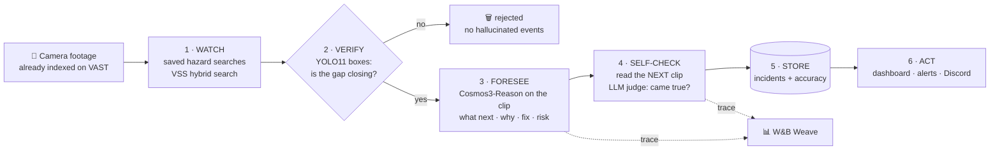
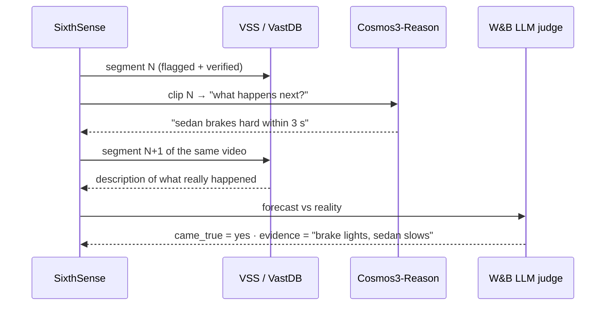

<div align="center">

# 👁️ SixthSense

### The sixth sense your cameras were missing.

**A video agent that watches CCTV, predicts what happens next, and then checks itself against what really happened.**

[](https://github.com/vast-data/vast-builders-challenge)
[](https://www.nvidia.com/en-us/ai/cosmos/)
[](https://docs.ultralytics.com/models/yolo11/)
[](https://coreweave.com/)
[](https://wandb.ai/site/weave/)
[](#-run-it)

[Demo](#-demo) · [How it works](#-how-it-works) · [CAMP stack](#-built-on-the-camp-stack) · [Results](#-results) · [Run it](#-run-it) · [For judges](#-for-the-judges)

</div>

---

## ⚡ TL;DR

> In *Final Destination 2* the pile-up had warning signs. In *Home Alone* the burglars cased the street for days.
> Both were on camera. Nobody watched.

Cities and companies record millions of hours of camera footage that **no human ever watches**. SixthSense turns that footage into a short list of moments that need a human, and for each one it says:

| | |
|---|---|
| 🎯 **What happens now** | grounded in the clip, from NVIDIA Cosmos3-Reason |
| 🔮 **What happens next** | a forecast for the next seconds (road) or the next visit (street) |
| 🧠 **Why** and 🛠️ **the fix** | the visible cause and one practical change |
| ✅ **Did it come true?** | the agent reads the *next* clip and grades its own forecast |

That last row is the point. Most video AI demos *claim* they are accurate. **SixthSense measures it, on the day, with no hand labels.**

---

## 🎬 Demo

> 📹 **Demo video:** _added after the live run (link here)_ · 🌐 **Live app:** workshop.thecosmoslabs.com → App (team 43)

<!-- screenshot: docs/screenshot.png added after the live run -->

**The 30-second story**
1. Open the **Road** tab - each card is a real highway clip with a risk score.
2. Read the forecast: *"the sedan brakes hard within 3 seconds"*.
3. Look at the pill: ✅ **came true** - the next clip shows the brake lights.
4. The header badge shows how many forecasts came true today.
5. Hit **Send alert** - the warning lands in the alert feed (and Discord).

---

## 🧩 The problem

| Pain | Today | With SixthSense |
|---|---|---|
| Hours of unwatched footage | Reviewed only after an accident | Reviewed continuously by an agent |
| "Search" tools | Find what *already* happened | Predict what happens **next** |
| AI hallucination | Model says an event happened; nobody checks | **YOLO boxes verify** every flagged moment |
| Trust | Vendors quote accuracy from a lab | The agent **grades itself** on your own footage |

---

## 🧠 How it works



| # | Step | What it does | Code | Powered by |
|---|---|---|---|---|
| 1 | **Watch** | Runs saved hazard queries per camera ("truck cutting in close", "sudden hard braking") | `pipeline/run.py · watch` | VSS search over **VastDB** (Cosmos Embed1 256-d vectors) |
| 2 | **Verify** | Measures how fast the gap between two vehicle boxes shrinks; rejects anything that isn't really closing | `run.py · verify` | **YOLO11** detections sidecar / `/v1/infer` |
| 3 | **Foresee** | Sends the clip to the reasoning model with a strict JSON prompt | `run.py · foresee` | **NVIDIA Cosmos3-Reason** on **CoreWeave** |
| 4 | **Self-check** | Finds the next segment of the same video and asks a judge if the forecast came true | `run.py · selfcheck` | **W&B serverless inference** |
| 5 | **Store** | Writes incidents + per-mode accuracy | `run.py · run` | JSON, VastDB-ready |
| 6 | **Act** | Cards, risk badges, "came true" pills, alerts, ask-the-footage box | `app/` | Python stdlib server on **VAST K8s** |

<details>
<summary><b>🔍 Step 2 in detail - the closing-gap score</b></summary>

For every sampled frame we take each pair of vehicle boxes and measure the gap between their edges, as a share of the frame width.

```
gap(t)   = edge distance between the two closest vehicles / frame width
score    = (gap(first frame) - smallest gap) / gap(first frame)
verified = score >= 0.30
```

A score of `0.48` means the gap shrank by 48% inside the clip. This is a **closing-gap score**, not a time-to-collision: overhead 2D boxes don't give real speed or distance, so we don't pretend they do.
</details>

<details>
<summary><b>🔮 Step 3 in detail - the forecast prompt</b></summary>

```text
You are a road-safety analyst watching highway CCTV. Look only at what is visible in this clip.
Answer in JSON only:
{"type", "what_happens", "what_next" (next 5-10 s), "why", "fix", "risk": 1-5}
If nothing risky is happening, set risk to 1 and what_next to "nothing notable".
Never invent people, vehicles or events you cannot see.
```
</details>

<details>
<summary><b>✅ Step 4 in detail - self-check with no hand labels</b></summary>



`accuracy = (yes + 0.5 × partly) / checked`. Forecasts with no next segment are marked `unknown` and left out.
</details>

---

## 🏕️ Built on the CAMP stack

The Builders Challenge maps to VAST's **CAMP** stack. SixthSense uses every layer:

| Layer | Provider | How SixthSense uses it |
|---|---|---|
| **C** - Coding agent | Cursor (+ Claude Code) | Built the whole app on the day from the challenge's `.cursor/skills` |
| **A** - Agent runtime | **VAST** | The agent and the app run on the team's VAST Kubernetes namespace; ingest runs as VAST DataEngine functions |
| **M** - Model services | **CoreWeave + NVIDIA** | Cosmos3-Reason (forecast), Cosmos Embed1 (search vectors), YOLO11 (verification) on CoreWeave GPUs; W&B inference for the judge |
| **P** - Platform | **VAST AI OS** | Video in VAST S3, segments + vectors + detections in **VastDB**, one index across every camera |

---

## 📊 Results

> Only numbers from today's real run go here. Nothing is estimated in advance.

| Mode | Camera | Candidates | Verified | Checked | Came true | Accuracy |
|---|---|---|---|---|---|---|
| 🛣️ Road | `i24_cam-1` (Nashville I-24) | _pending_ | _pending_ | _pending_ | _pending_ | _pending_ |
| 🏘️ Street | `neighborhood_cam-1` (2 days) | _pending_ | _pending_ | _pending_ | _pending_ | _pending_ |

Weave trace: _link added after the run_

---

## 🗂️ Example output

```json
{
  "camera_id": "i24_cam-1",
  "type": "close cut-in",
  "verified": true,
  "verify_note": "closest gap 0.8% of frame width, shrank 48% over 12 frames",
  "what_happens": "A white truck moves into the middle lane with little space in front of a sedan.",
  "what_next": "The sedan brakes hard within 3 seconds.",
  "why": "The truck changes lane without a gap, at the same speed as the sedan.",
  "fix": "Lane-change warning before the merge; following-distance camera here.",
  "risk": 4,
  "came_true": "yes",
  "came_true_evidence": "the sedan slows sharply and brake lights show"
}
```
<sub>Shape of a real incident. Values above are illustrative until the live run replaces them.</sub>

---

## 🚀 Run it

On the challenge lab VM (credentials and endpoints are already in `/config/<team>.config`):

```bash
git clone https://github.com/Dinesh-Sunny/sixthsense && cd sixthsense

python3 pipeline/probe.py                         # 1. check every API, save real JSON shapes
python3 pipeline/run.py --mode road   --limit 12  # 2. watch → verify → foresee → self-check
python3 pipeline/run.py --mode street --limit 12
PORT=8080 python3 app/main.py                     # 3. local preview
bash deploy.sh                                    # 4. ship to K8s → workshop.thecosmoslabs.com → App
```

| Flag | Values | Use when |
|---|---|---|
| `VERIFY_MODE` | `boxes` (default) · `cosmos` | no per-frame boxes → ask Cosmos a strict yes/no |
| `FORESEE_VIA` | `direct` (default) · `text` | Cosmos can't take the clip → reason over the stored description |
| `LLM_MODEL` | any W&B inference model id | picks the self-check judge (falls back to Cosmos) |
| `DISCORD_WEBHOOK_URL` | webhook URL | alerts also post to Discord |

No dependencies: the app and pipeline use the Python standard library. `pip install weave` turns on tracing.

---

## 🏗️ Project structure

```
sixthsense/
├── pipeline/
│   ├── vss.py        # VSS backend client: login, search, segments, detections, stream
│   ├── models.py     # Cosmos3-Reason + YOLO11 (direct), W&B inference, Weave ops
│   ├── modes.py      # one engine, mode = config (road / street queries)
│   ├── run.py        # watch → verify → foresee → self-check → store
│   └── probe.py      # live smoke test, records real API shapes
├── app/
│   ├── main.py       # stdlib server: /api/*, /clip proxy (Range), /api/ask
│   ├── index.html    # the dashboard
│   └── incidents.json, metrics.json
├── deploy.sh         # ConfigMap + Secret + Deployment + Ingress /app
├── AGENTS.md · CLAUDE.md · .claude/   # AI coding setup used to build it
└── docs/
```

---

## 🧭 Design decisions

| Decision | Why |
|---|---|
| **Predict, then grade** | A forecast you can check beats a caption you have to trust |
| **YOLO before Cosmos** | Cheap boxes filter out hallucinated events before the expensive reasoning call |
| **One engine, mode = config** | Road and Street differ only in queries and prompts - new cameras are a config change |
| **Stdlib only** | The app ships as a Kubernetes ConfigMap: no image build, no registry, starts in a second |
| **Privacy first** | Vehicles and behaviour only - no faces, no identities |
| **Honest numbers** | Fixture data is labelled; results are only from the live run |

## ⚠️ Limits (honest)
- Closing-gap is a 2D proxy, not true speed or distance.
- "Came true" is judged from the next segment's description, so it inherits that description's quality.
- Street mode matches lookalike vehicles by description ("a dark van matching this"), not by identity.

## 🛣️ Next
- [ ] Re-ingest with a SixthSense-tuned prompt and measure accuracy before/after in Weave
- [ ] Store incidents in a VastDB table next to `vss-collection`
- [ ] Multi-camera tracking across the I-24 scenes
- [ ] Real-time mode on live streams

---

## 🏆 For the judges

| You care about | Where to look |
|---|---|
| **VAST** - data + platform | One VastDB index across cameras, VSS search, segments, K8s runtime → `pipeline/vss.py`, `deploy.sh` |
| **NVIDIA** - Cosmos | Cosmos3-Reason used for *cause and forecast*, not captions → `foresee`, prompt above |
| **W&B** - agents + evals | Every step is a Weave op; self-measured accuracy → `models.py`, `selfcheck` |
| **Builders** - skills | Built from the challenge's `.cursor/skills` APIs |

## 👥 Team
**Dinesh Sunny** - full-stack developer, CTO at PiAcademy · [GitHub](https://github.com/Dinesh-Sunny)

## 🙏 Thanks
VAST Data, NVIDIA, CoreWeave, Weights & Biases, Cursor and tokens& for the stack, the footage and the day.

<div align="center"><sub>Never leave your cameras Home Alone.</sub></div>
